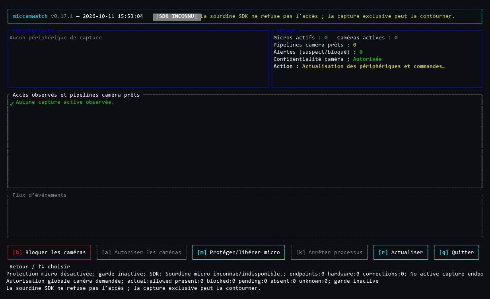
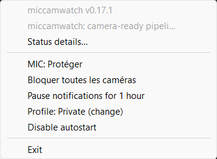

# MicCamWatch

**Free, open-source microphone and camera activity monitoring for Windows, Linux, and macOS.**

[](https://miccamwatch.pages.dev/)
[](https://github.com/Roman-Cuisset/miccamwatch/actions/workflows/ci.yml)
[](https://github.com/Roman-Cuisset/miccamwatch/releases/latest)
[](https://github.com/Roman-Cuisset/miccamwatch/releases)
[](LICENSE)

MicCamWatch (`mcw`) helps you understand which applications are using your
microphone or camera. It reads operating-system metadata, reports available
process identities, and offers a terminal dashboard, native tray/menu-bar
controls, notifications, and scoped privacy actions.

- **Official website:** [miccamwatch.pages.dev](https://miccamwatch.pages.dev/)
- **Downloads:** [GitHub Releases](https://github.com/Roman-Cuisset/miccamwatch/releases)
- **Privacy:** [official Privacy Policy](https://miccamwatch.pages.dev/privacy)
- **Local monitoring:** no application telemetry, background analytics, or automatic cloud reporting.
- **No media recording:** MicCamWatch does not record audio or capture camera frames.

Detection and controls depend on the operating system and available evidence.
An unknown or incomplete observation is **not** an all-clear.

## Overview & Screenshots

| Interactive Terminal Dashboard (`mcw top`) | Native Desktop Tray (`mcw tray`) |
| :---: | :---: |
|  |  |
| *Access events, process identities, and keyboard controls* | *Tray status, profiles, and quick controls* |

These are authentic historical Windows **0.17.1** captures, not mock-ups or
screenshots of the unreleased 0.21.0 windows. Their
[provenance and limits](site/assets/captures.json) are retained.

[Install](#quick-start) · [Features](#features) · [Platform support](#supported-operating-systems) ·
[Usage](#everyday-usage) · [Safety](#understanding-status-and-controls) · [Documentation](#documentation)

## Release status

| Channel | What is available |
| --- | --- |
| **Public stable: [0.20.0](https://github.com/Roman-Cuisset/miccamwatch/releases/tag/v0.20.0)** | Windows x64 ZIP/MSI, Linux x64 archive, macOS Apple Silicon/Intel archives and DMGs. CLI, TUI, tray/menu-bar controls; native consultation window on macOS. |
| **Development candidate: 0.21.0 — not published** | Redesigned native Windows/GTK/AppKit interfaces, unified activation and retained-window behavior, and Linux ARM64 candidate packages. |

**The downloads below install 0.20.0, not 0.21.0.** The candidate is on
[`work/linux-arm64-021`](https://github.com/Roman-Cuisset/miccamwatch/tree/work/linux-arm64-021);
its native CI results do not constitute a public release or physical ARM certification.
See [validation and release status](docs/VALIDATION.md) for exact evidence.

## Features

- **Live observations:** microphone and camera activity, with process/PID attribution when the platform can prove it.
- **Readable interfaces:** a live terminal dashboard, native tray/menu-bar status, notifications, and optional system sounds.
- **Scoped controls:** supported microphone mute and owned camera controls, with explicit permission and restoration handling.
- **Profiles and preferences:** Balanced, Private, Meeting, and Development; saved settings and opt-in autostart.
- **Diagnostics:** collector health, permissions, incomplete coverage, and requested versus effective protection.
- **Automation:** versioned JSON snapshots, JSONL events, local history, and TOML policy rules.
- **Seven languages:** English, French, German, Spanish, Japanese, Simplified Chinese, and Russian.

The core is Rust with native platform integration, not a web application or
media recorder. Runtime requirements and permissions differ by platform.

## Supported Operating Systems

The following packages are available in **stable 0.20.0**:

| Platform | Monitoring | Controls and prerequisites |
| --- | --- | --- |
| **Windows 10 / 11, x64** | Native audio sessions and camera-activity evidence; verified process attribution where available. | Capture-endpoint mute; administrator-approved camera device control. |
| **Desktop Linux, x64** | Running PipeWire capture links and authenticated process identity; limited direct V4L2 evidence. | glibc 2.35+, user PipeWire service; optional separately installed Polkit-authorized USB camera helper. |
| **macOS 15+, Apple Silicon / Intel** | CoreAudio input activity; CoreMediaIO camera running-state with unknown camera client/PID. | Writable input mute; manually approved MCW-owned camera restriction profile. |

Linux desktop effects require the appropriate notification service and a
StatusNotifierItem host. macOS notification and profile authorization remain
controlled by the operating system. Monitoring does not require running the
whole application as administrator/root.

**Linux ARM64 belongs to the unpublished 0.21.0 candidate.** Native hosted-runner
qualification is not a Raspberry Pi or USB-device compatibility guarantee.
See [platform limits](docs/USAGE.md#observation-and-control-limits).

## Quick Start

### Windows — MSI or portable ZIP

Download the [0.20.0 MSI](https://github.com/Roman-Cuisset/miccamwatch/releases/download/v0.20.0/miccamwatch-windows-x86_64.msi)
for a per-user installation, PATH registration, and a Start Menu entry.
Alternatively, extract the [portable ZIP](https://github.com/Roman-Cuisset/miccamwatch/releases/download/v0.20.0/miccamwatch-windows-x86_64.zip).
Open a new terminal after MSI installation; for a ZIP, run the executables from
its extracted directory or configure PATH explicitly.

```powershell
mcw --version
mcw doctor
mcw status --lang en
mcw top
```

The Windows package contains `mcw.exe` (CLI) and `mcw-tray.exe` (console-free
tray host). The MSI is their installer, not a third resident application.
The new full Windows consultation interface is a **0.21.0 candidate** feature.

### macOS — native application

Choose the matching 0.20.0 DMG:
[Apple Silicon](https://github.com/Roman-Cuisset/miccamwatch/releases/download/v0.20.0/miccamwatch-macos-aarch64.dmg) ·
[Intel](https://github.com/Roman-Cuisset/miccamwatch/releases/download/v0.20.0/miccamwatch-macos-x86_64.dmg).
Mount it, drag `MicCamWatch.app` to Applications, then open the copied application.
The menu-bar icon provides access to the native consultation and controls.

The DMG does not install the CLI on PATH or enable autostart implicitly.
Bundles are ad-hoc sealed, **not Developer ID signed or notarized**;
[security and signing guidance](docs/SIGNING.md) explains the limits.
Do not bypass Gatekeeper or quarantine protections.

### Linux and macOS — command-line installation

Download an immutable installer from the published 0.20.0 source and inspect it
before execution:

```sh
curl --proto '=https' --tlsv1.2 -fsSL \
  https://raw.githubusercontent.com/Roman-Cuisset/miccamwatch/a26522028eafe02591f58c03ceb5c367f2d5d60b/installer/install.sh \
  -o mcw-install.sh
sh mcw-install.sh --version v0.20.0 --add-path
```

This installs into `$HOME/.local/bin` without sudo. `--add-path` explicitly
permits managed shell PATH configuration; use `--no-modify-path` to leave it alone.
The installer verifies the selected release archive against its `SHA256SUMS`;
that manifest does **not** contain a checksum for the installer script itself.

For archive verification, dependencies, custom prefixes, package-manager
ownership, and old-version migrations, see the [installation guide](docs/INSTALLATION.md).
Windows binaries may also be unsigned: checksums and GitHub provenance are not
an Authenticode signature or a reason to ignore a security warning.

## Everyday usage

| Command | Purpose |
| --- | --- |
| `mcw status` | Show the current observation and health. |
| `mcw status --json` | Produce a versioned machine-readable snapshot. |
| `mcw watch --json` | Stream access events and health changes. |
| `mcw top` | Open the interactive terminal dashboard. |
| `mcw tray` | Run the native tray/menu-bar frontend. |
| `mcw doctor` | Explain monitoring capabilities, prerequisites, and failures. |
| `mcw config settings-path` | Locate saved application preferences. |
| `mcw history path` | Locate local event history. |

Use `mcw --help` and each command's `--help` for the options in your installed
version. For example, select French with `mcw status --lang fr`.

Desktop profiles select policy/preferences; they do **not** grant capture
permissions or automatically mute/block devices. Balanced and Meeting currently
share the same policy. An explicit `--config` takes precedence over saved profiles.

In stable 0.20.0, `mcw tray open` is a **macOS** consultation command.
Cross-platform retained consultation windows belong to the 0.21.0 candidate.
See [interfaces and preferences](docs/USAGE.md#desktop-and-terminal-interfaces)
and the [full command guide](docs/USAGE.md#commands).

## Understanding status and controls

- **Active** is observed activity within the collector's scope, not a universal guarantee of frame flow or attribution.
- **Ready** is a possible capture pipeline/handle, not confirmed recording.
- **Unknown / unavailable / partial** means evidence is missing or incomplete; it must not be read as idle or safe.
- **Requested protection** and **effective control** are separate from observed activity.
- **SDK mute is not capture permission denial.** Exclusive, ASIO, direct-driver, ALSA, or other unsupported paths may bypass the supported scope.

Windows camera changes request administrator approval. Linux USB control needs
separate reviewed root-helper setup and explicit Polkit authorization. macOS
camera profile approval/removal is manual; it does not grant camera TCC access
or identify the camera client.

Before uninstalling or replacing an installation, explicitly restore owned
changes and resolve pending restoration. Closing a UI is **not** release.
Do not delete ownership journals, force-stop protection owners, or recover
quarantined files as a shortcut.

[Control limits and recovery](docs/USAGE.md#observation-and-control-limits) ·
[Safe updates and uninstall](docs/INSTALLATION.md#updates)

## Privacy

Monitoring uses local OS metadata rather than microphone samples or camera frames.
Settings and history remain in application-data/XDG directories.
Local history is enabled by default and rotates by size; it has no automatic
age-based expiration. Manage it explicitly when sharing a computer or diagnostics.

MicCamWatch has no automatic telemetry/crash upload. Explicit installation and
update commands contact release hosts; an explicitly online trust policy can
also perform network checks. Cloudflare and GitHub have their own hosting and
download processing, separate from the local application.

Read the [official Privacy Policy](https://miccamwatch.pages.dev/privacy) and
[local storage documentation](docs/USAGE.md#logs-and-privacy).

## Documentation

| Read this for… | Guide |
| --- | --- |
| Downloads, verification, updates, uninstall, source builds | [Installation](docs/INSTALLATION.md) |
| Commands, profiles, controls, policies, diagnostics | [Usage and safety](docs/USAGE.md) |
| Public release, candidate qualification, hardware limits | [Validation](docs/VALIDATION.md) |
| Versioned changes and historical CI/provenance evidence | [Release history](docs/RELEASE_HISTORY.md) |
| Collector contracts, ownership, platform implementation | [Architecture](docs/ARCHITECTURE.md) |
| Authenticode, Defender, provenance, security warnings | [Signing and safe handling](docs/SIGNING.md) |
| Static-site build, languages, Cloudflare configuration | [Website maintenance](docs/WEBSITE.md) |
| Development priorities and handoff records | [Roadmap](docs/ROADMAP.md) |

The [documentation index](docs/README.md) separates user guides, technical
references, current validation, and historical records.

## Contributing and support

[Report a reproducible problem](https://github.com/Roman-Cuisset/miccamwatch/issues)
with your installed version, OS/architecture, relevant `doctor` output, and the
steps that trigger it. Redact usernames, paths, application identities, and
other private information before posting diagnostics.

For development, follow the [platform-specific build instructions](docs/INSTALLATION.md#build-from-source)
and [architecture contracts](docs/ARCHITECTURE.md). Do not treat a successful build
or hosted CI run as proof of hardware enforcement or universal monitoring coverage.
The full release/CI narrative lives in the documentation rather than this overview.

## License

Free software under the [MIT License](LICENSE).
